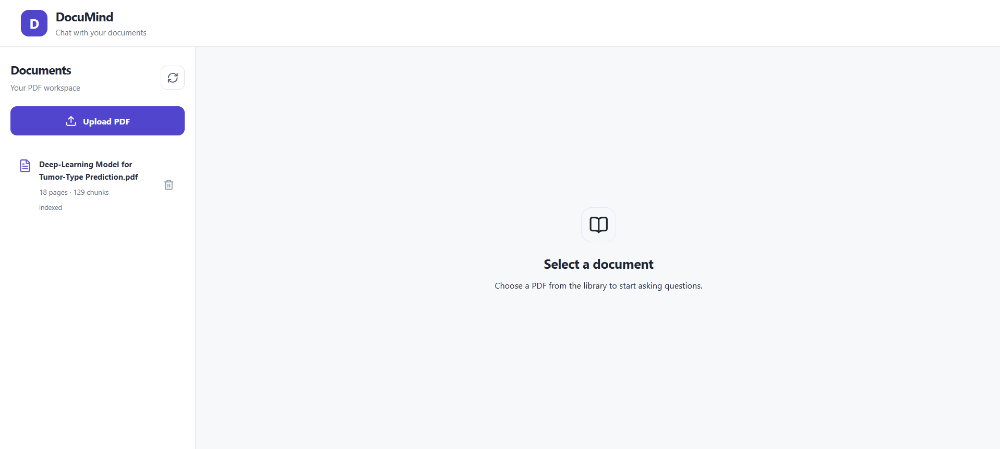
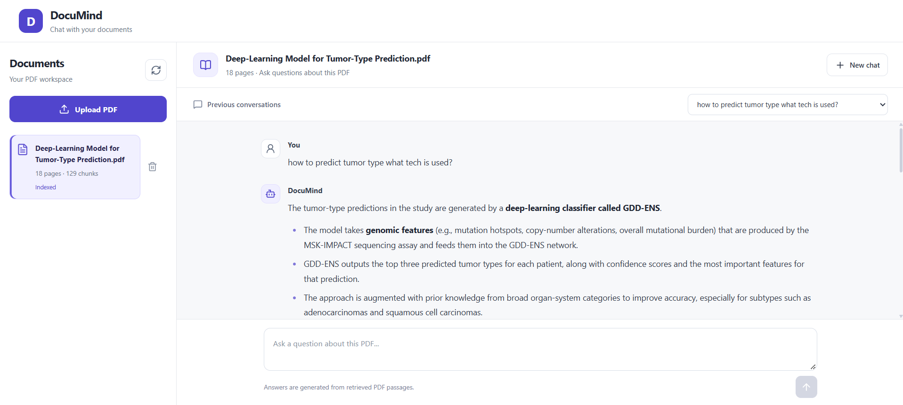
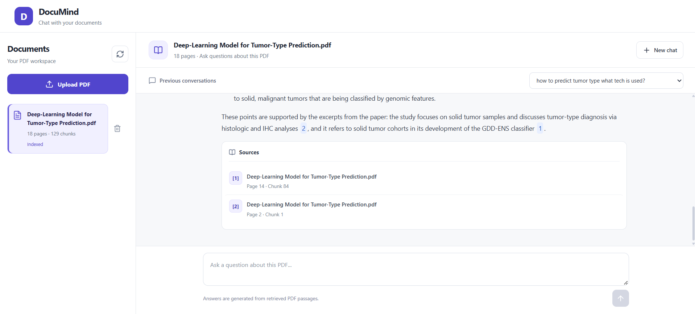
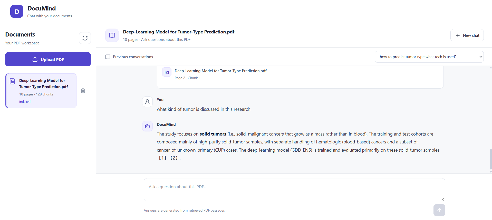
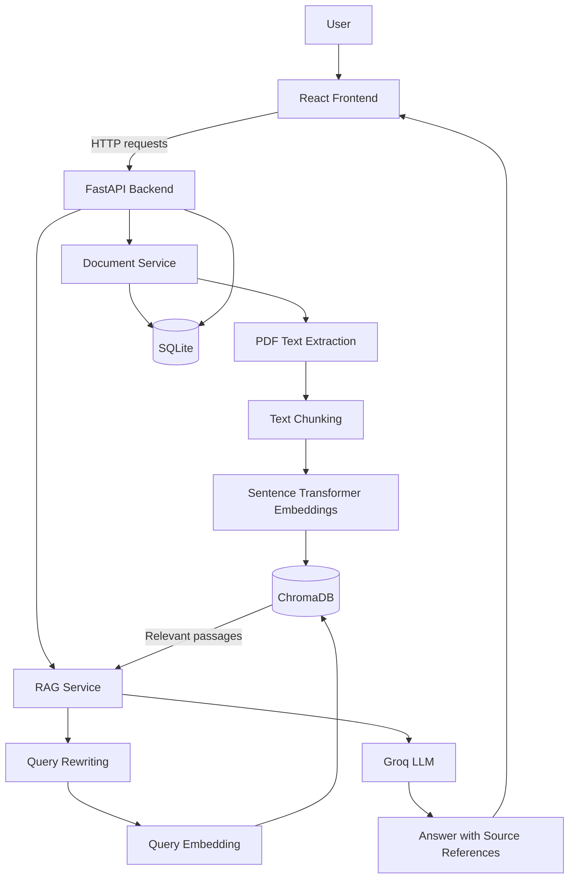

# DocuMind — Chat with Your PDFs Using RAG

DocuMind is a full-stack PDF question-answering application that allows users to upload PDF documents and ask questions about their contents using Retrieval-Augmented Generation (RAG).

Instead of relying only on a language model's existing knowledge, DocuMind retrieves relevant passages from the selected document and uses them as context to generate answers. Responses can include source citations so users can identify the passages used to answer their questions.

## Screenshots

| Document Library                                           | PDF Question Answering                           |
| ---------------------------------------------------------- | ------------------------------------------------ |
|  |  |

| Source Citations                                           | Follow-up Conversation                                         |
| ---------------------------------------------------------- | -------------------------------------------------------------- |
|  |  |

## Features

- **PDF upload and text extraction:** Extracts text from supported, text-based PDF documents.
- **Document processing:** Splits extracted text into overlapping chunks while retaining page and chunk metadata.
- **Semantic search:** Uses sentence embeddings to find relevant passages based on a user's question.
- **Document-specific retrieval:** Restricts retrieval to the selected document.
- **Grounded answers:** Supplies retrieved passages to the language model as context for answering questions.
- **Source citations:** Returns references to the retrieved passages used in an answer.
- **Conversation history:** Supports follow-up questions using recent conversation context.
- **Persistent storage:** Stores document and conversation metadata in SQLite and document embeddings in ChromaDB.
- **Interactive web interface:** Provides a React frontend for uploading documents and asking questions.
- **API documentation:** Exposes FastAPI endpoints and interactive API documentation through Swagger UI.

## Architecture



### Main components

| Component             | Responsibility                                                  |
| --------------------- | --------------------------------------------------------------- |
| React + Vite          | User interface for document upload, chat, and source references |
| FastAPI               | REST API and request handling                                   |
| pypdf                 | Extracts text from PDF files                                    |
| Sentence Transformers | Generates semantic embeddings using `all-MiniLM-L6-v2`          |
| ChromaDB              | Stores and retrieves document chunk embeddings                  |
| SQLite + SQLAlchemy   | Persists document and conversation metadata                     |
| Groq API              | Powers query rewriting and answer generation                    |
| React Markdown        | Renders formatted assistant responses                           |

## How RAG Works in DocuMind

1. **Upload:** The user uploads a PDF through the frontend.
2. **Extract:** The backend extracts text and page information from the PDF.
3. **Chunk:** The extracted text is divided into overlapping chunks.
4. **Embed:** A Sentence Transformers model converts each chunk into a vector embedding.
5. **Store:** The embeddings and associated metadata are stored in ChromaDB, while document metadata is persisted in SQLite.
6. **Ask:** The user asks a question about the selected document.
7. **Retrieve:** The backend prepares the search query, generates its embedding, and retrieves relevant chunks from that document.
8. **Generate:** The retrieved passages and conversation context are sent to the Groq-powered language model.
9. **Cite:** The generated answer and its source references are returned to the frontend.

## Technology Stack

**Frontend**

- React
- Vite
- JavaScript
- CSS
- Axios
- React Markdown
- Remark GFM
- Lucide React

**Backend**

- Python
- FastAPI
- SQLAlchemy
- pypdf
- Sentence Transformers
- ChromaDB
- Groq API

**Storage**

- SQLite for application metadata and conversation persistence
- ChromaDB for vector embeddings

## Project Structure

```text
DocuMind/
├── backend/
│   ├── app/
│   │   ├── api/
│   │   ├── core/
│   │   ├── models/
│   │   ├── schemas/
│   │   └── services/
│   ├── tests/
│   ├── .env.example
│   └── requirements.txt
├── frontend/
│   ├── public/
│   ├── src/
│   │   ├── components/
│   │   └── ...
│   ├── package.json
│   └── vite.config.js
├── docs/
│   └── screenshots/
├── .gitignore
└── README.md
```

_The tree illustrates the main areas of the project. Actual filenames and subdirectories may vary._

## Getting Started

### Prerequisites

- Python compatible with the installed backend dependencies
- Node.js and npm
- A Groq API key

### 1. Clone the repository

```bash
git clone https://github.com/YOUR_USERNAME/DocuMind.git
cd DocuMind
```

Replace `YOUR_USERNAME` with your GitHub username.

### 2. Configure the backend

```powershell
cd backend
python -m venv .venv
```

Activate the virtual environment in PowerShell:

```powershell
.\.venv\Scripts\Activate.ps1
```

Install the dependencies:

```powershell
python -m pip install -r requirements.txt
```

Copy `.env.example` to `.env` and add your own Groq API key.

```powershell
Copy-Item .env.example .env
```

Edit `.env` locally. Never commit it to Git.

### 3. Start the backend

From the `backend` directory, start the FastAPI application using the entry point configured in the project. For example, if the application instance is `app` in `app/main.py`:

```powershell
uvicorn app.main:app --reload
```

Open the interactive API documentation at:

`http://127.0.0.1:8000/docs`

### 4. Start the frontend

Open a second terminal at the project root:

```powershell
cd frontend
npm install
npm run dev
```

Open the local URL printed by Vite, usually:

`http://localhost:5173`

### 5. Try DocuMind

1. Upload a supported, text-based PDF.
2. Select the uploaded document.
3. Ask a question whose answer is present in the PDF.
4. Inspect the answer and its source citations.
5. Ask a related follow-up question to test conversational context.

## API

FastAPI provides interactive endpoint documentation at `/docs` while the backend is running. Use it to inspect the available routes, request schemas, and response formats.

## Configuration

| Variable       | Purpose                                           |
| -------------- | ------------------------------------------------- |
| `GROQ_API_KEY` | API key used to access the Groq service           |
| `GROQ_MODEL`   | Model identifier used for language-model requests |

Use the values in `.env.example` as a starting point. Keep real credentials in your local `.env` file.

## Current Limitations

- PDF processing depends on extractable text; scanned PDFs may require OCR.
- Answer quality depends on the document content, retrieval quality, and language model.
- The application requires a valid Groq API key for its LLM-powered features.
- Local databases and vector-store files are machine-specific and are not included in the repository.

## Future Improvements

- OCR support for scanned PDFs
- Automated evaluation of retrieval and answer quality
- More robust automated tests for retrieval, citations, and conversation history
- Deployment with managed storage and production configuration

## License

No license has been added yet. Unless a license is included in this repository, others should not assume they have permission to reuse, modify, or redistribute the code.
